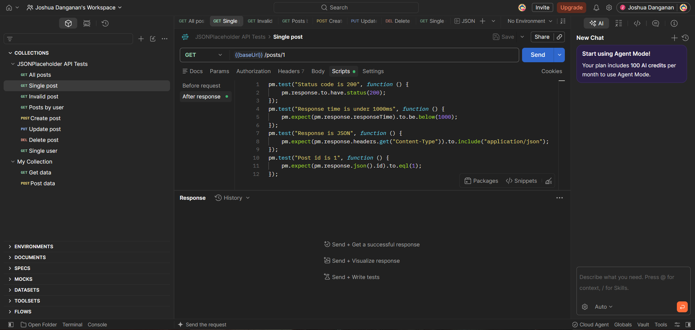
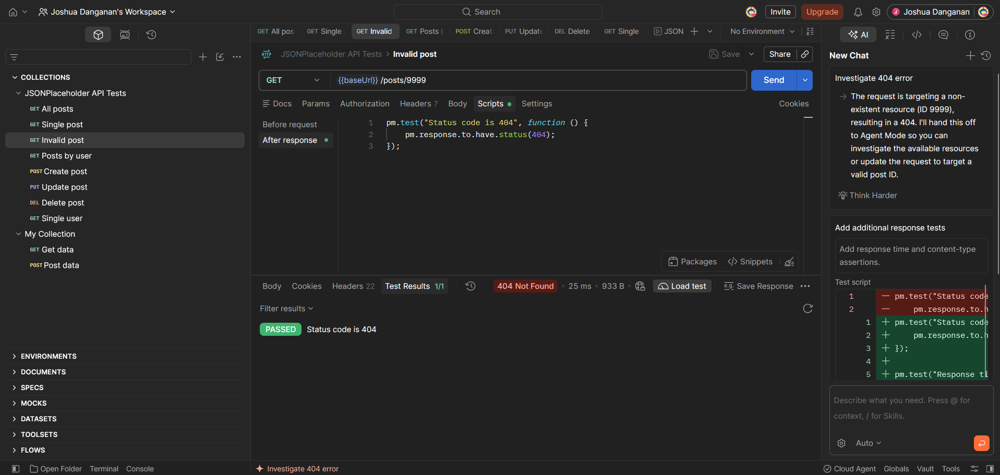

# Postman API Testing: JSONPlaceholder

## Goal

Test the JSONPlaceholder public REST API using Postman. I wrote 8 requests covering GET, POST, PUT, and DELETE, added automated checks to each one, and ran them together as a collection.

## Tools Used

- Postman
- REST API (JSONPlaceholder, https://jsonplaceholder.typicode.com)
- JSON
- Postman test scripts (JavaScript snippets)

## Test Cases

| # | Request | Method | Endpoint | What It Checks | Result |
|---|---|---|---|---|---|
| 1 | All posts | GET | /posts | Status 200, response time under 1000 ms, JSON response | Pass |
| 2 | Single post | GET | /posts/1 | Status 200, response time, JSON response, post id is 1 | Pass |
| 3 | Invalid post | GET | /posts/9999 | Status 404 (negative test) | Pass |
| 4 | Posts by user | GET | /posts?userId=1 | Status 200, response time, JSON response, all posts belong to user 1 | Pass |
| 5 | Create post | POST | /posts | Status 201, response contains the title I sent | Pass |
| 6 | Update post | PUT | /posts/1 | Status 200, response contains the updated title | Pass |
| 7 | Delete post | DELETE | /posts/1 | Status 200 | Pass |
| 8 | Single user | GET | /users/1 | Status 200, response time, JSON response, user id is 1 | Pass |

## Screenshots

### Collection run results

### Test script example

### Negative test (404)

## Results

- 8 requests run in one collection
- 19 tests passed, 0 failed
- Covered success cases, a filtered request, and one negative test

## Notes

- JSONPlaceholder fakes write operations. POST, PUT, and DELETE return a success response, but nothing is actually saved on the server. Because of this, my checks for those requests only verify the response, not that the data was stored.
- Because it is a practice API, I did not find any real bugs, so I am not reporting any.

## Problems and Fixes

| Issue | Fix |
|---|---|
| The "Response is JSON" test failed with a header assertion error | I read the actual header value (`application/json; charset=utf-8`) and changed the check to confirm the header includes `application/json` |
| The POST test returned 200 and failed both checks | The request method was still set to GET. I changed it to POST and both tests passed |
| The collection run showed "request URL is empty" | One request had no URL. I filled it in and reran the collection |

## What I Learned

- How to build and organize a Postman collection with a shared variable
- How to write basic test assertions for status codes, response time, and JSON fields
- How to write a negative test for an error response
- How to run a full collection and read the results

## Files

- `JSONPlaceholder API Tests.postman_collection.json`: the exported Postman collection
- `screenshots/`: images from the test run

To run it yourself: import the JSON file into Postman, then right-click the collection and choose Run collection.
